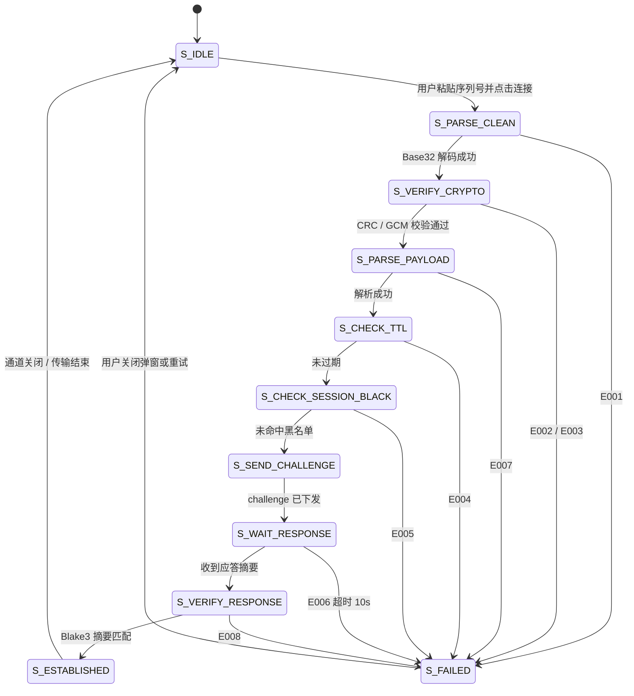
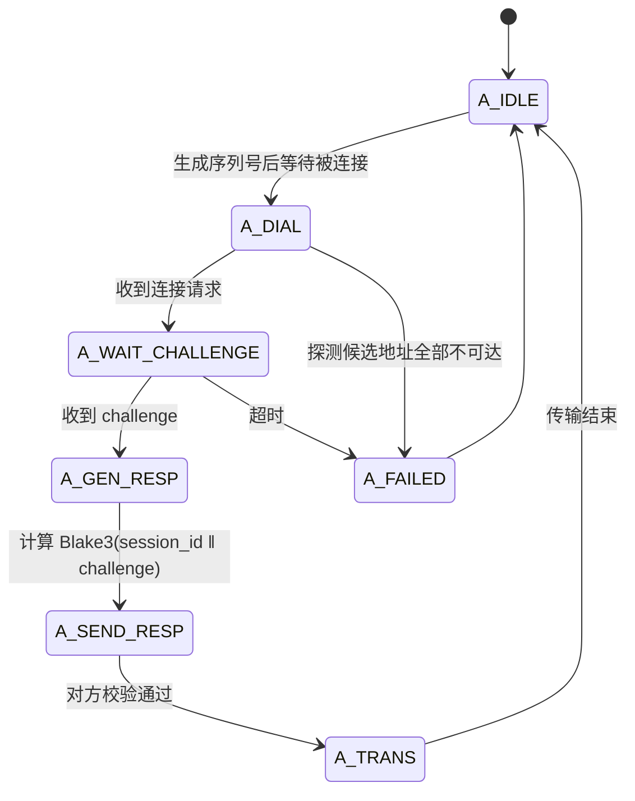

# LanLink 外网邀请序列号｜产品需求文档

| 项    | 内容                                          |
| ---- | ------------------------------------------- |
| 文档名称 | LanLink 外网邀请序列号方案                           |
| 版本   | V1.0（协议 + 状态机 + PRD 交互，定稿）                  |
| 适用产品 | LanLink（PC GUI 局域网 / 跨网 P2P 文件传输工具，Rust 实现） |
| 关联体系 | 局域网邀请（6 位短码）为独立协议，不在本文档范围内                  |
| 更新日期 | 2026-11-16                                  |
| 文档状态 | 已交付（D2 原型定版、D3 协议层 26 单测通过、D4 短码文档见 `lanlink-lan-code-PRD.md`） |

***

## 0. 一页速览（TL;DR）

* **外网序列号**：一串外观酷似软件注册码的大写分组串，如 `K7G2S9-5MNP8R-2HJK7T-9QG3S5-AK62M7-HN8P3J`，自包含己方候选地址（优先公网 IPv6），**不依赖任何信令服务器**。
* **传输链路**：Base32（定制大写字符集）⇄ 私有紧凑二进制 Payload ⇄ 可选 LZ4 自适应压缩 ⇄ 可选 AES-GCM-256 口令加密。
* **安全性**：CRC32 防损坏/防篡改 + TTL 15min + session 内存黑名单 + Blake3 动态质询应答，**三层防重放**；可选口令加密实现桌面级保密。
* **体验**：PC↔PC 全程纯文本复制粘贴，不依赖摄像头、不强制掏手机；序列号只在内存中存在，关闭弹窗即销毁。

**核心价值判断**：用「凭证自包含地址」替代「信令服务器查表」，把运维成本降为零，代价是把搬运工作交给用户和第三方 IM。因此**体验必须做到一条消息、一次粘贴、零学习成本**，否则无服务器架构会被用户成本反噬。

***

## 1. 设计目标与约束

### 1.1 设计目标

| 编号 | 目标   | 说明                                             |
| -- | ---- | ---------------------------------------------- |
| G1 | 无服务器 | 不运营任何中继/信令后端，地址信息打包在凭证内，由用户通过第三方 IM（微信等）人工搬运   |
| G2 | 自包含  | 拿到序列号即可获得全部候选地址，不需要广播查表、不需要回调服务                |
| G3 | 紧凑   | 抛弃 JSON 文本，自定义定长二进制结构，体积压到理论上限附近               |
| G4 | 迷惑性  | 视觉与语义对外表现为「软件激活序列号 / 注册码」，降低第三方识别为 P2P 连接凭证的概率 |
| G5 | 可控安全 | 默认轻量（CRC32），高敏感场景可一键开启口令加密                     |
| G6 | 防重放  | 静态凭证不可复用、抓包报文不可重放、数据流分片不可重放                    |

### 1.2 约束（已定下的取舍）

| 取舍项                    | 决定              | 理由                        |
| ---------------------- | --------------- | ------------------------- |
| 是否引入固定魔数（Magic Number） | 不引入             | 换取抓包隐匿性；靠字段合法性 + 长度约束做弱识别 |
| 是否做持久化黑名单              | 不做（仅内存 HashSet） | 符合无服务器定位；用短 TTL 补偿重启窗口    |
| 是否用 zstd               | 不用，仅 LZ4        | 小包场景 zstd 帧头开销过大，压缩后常反而膨胀 |
| 是否默认加密                 | 不默认，手动开关        | 熟人场景降低操作摩擦；口令加密作为增强项      |
| 是否用二维码作主路径             | 不作为主路径          | PC 端扫码体验别扭；二维码降级为可选彩蛋     |

### 1.3 非目标（Non-Goals）

* IPv4 CGNAT 环境下的自动 NAT 打洞（不实现 UDP hole punching 的复杂协商）。
* 中继（RELAY）传输、账号体系、好友关系、云端历史记录。

***

## 2. 体系总览：两套邀请，互不混用

| 维度     | 局域网邀请            | 外网序列号（本文档主体）                   |
| ------ | ---------------- | ------------------------------ |
| 触发场景   | 同一网段 / 同一 VLAN   | 异地、跨互联网                        |
| 凭证形态   | 6 位短码，如 K7G2S9   | 长串 Base32 分组，如 K7G2S9-5MNP8R-… |
| 是否携带地址 | 不携带              | 自包含候选地址列表                      |
| 发现方式   | mDNS 广播查询 + 子网扫描 | 直接依据凭证内地址发起连接                  |
| 是否需要外网 | 不需要，断网可用         | 需要两端有一定连通性（IPv6 最佳）            |
| 有效期    | 随程序运行期           | 15 分钟（TTL = 900s）              |
| 失败兜底   | 手动输入 IP:端口       | 人工重发新序列号 / 电话核对                |

> **产品规则（FR-X1）**：UI 用两个独立 Tab 承载，视觉明显区分，**不允许用户在同一输入框里混输两种凭证**（输入框按长度与格式自动判别，判别失败给明确提示）。

***

## 3. 功能需求清单

| 编号    | 需求名称      | 优先级 | 说明                                        |
| ----- | --------- | --- | ----------------------------------------- |
| FR-01 | 生成外网序列号   | P0  | 采集候选地址 → 序列化 → 压缩 → 加密（可选）→ Base32 分组展示   |
| FR-02 | 复制序列号     | P0  | 一键复制完整串（含 -），复制成功给明确反馈                    |
| FR-03 | 粘贴与容错清洗   | P0  | 自动去 -/空白/换行、统一大写，不报错不阻断                   |
| FR-04 | 连接与五级校验   | P0  | CRC/GCM → Payload → TTL → 黑名单 → 质询应答      |
| FR-05 | 口令保护（发送端） | P1  | 勾选后设 4~6 位纯数字口令 + 二次确认                   |
| FR-06 | 口令输入（接收端） | P1  | 检测到 ENCRYPT=1 时自动弹出                       |
| FR-07 | 四态状态提示    | P0  | 灰=就绪 / 蓝=进行中 / 绿=成功 / 红=失败 / 橙=连通失败       |
| FR-08 | 错误码映射文案   | P0  | E001~E009，UI 只按 error_code 映射，禁止前端硬编码判断 |
| FR-09 | 随时取消      | P0  | 任意阶段取消 → 中断状态机 → 释放 challenge → 回 S_IDLE |
| FR-10 | 内存即焚      | P0  | 序列号与口令派生密钥不落盘，关窗即 zeroize                 |
| FR-11 | Tab 隔离    | P0  | 两套凭证不共用输入缓冲、不共用状态区                        |
| FR-12 | 连续生成      | P1  | 允许多次生成，UI 提示「仅使用最新一次生成的序列号」               |

***

## 4. 协议规约

### 4.1 整体链路

**生成端（发起方 A）**

```
业务数据(候选地址 + session_id + ts)
   → 自定义二进制 Payload
   → LZ4 自适应压缩（带开关位）
   → [可选] AES-GCM-256 口令加密
   → Base32(定制大写字符集) 编码
   → 每 6 字符插 '-'
   → UI 展示「外网序列号」
```

**接收端（B）**

```
粘贴序列号
   → 清洗（去 '-'、空白，统一大写）
   → Base32 解码
   → [条件] AES-GCM 解密 + Tag 校验
   → [条件] LZ4 解压
   → 二进制 Payload 解析
   → 五级校验（CRC → TTL → session 黑名单 → 质询 → 应答比对）
   → 建立 P2P 数据通道
```

### 4.2 字符集与展示规范

**Base32 字符集（锁定，32 个符号）**

```
ABCDEFGHJKLMNPQRSTUVWXYZ23456789
```

* 剔除易混淆字符：`0`、`1`、`I`、`O`、`L`（避免手抄与截图 OCR 误读）
* 每字符承载 5 bit，编码输出统一大写
* 解码容错：输入先 `to_uppercase()`，再过滤 `-`、空格、`\n`、`\t`、`\r`

**展示格式**

* 每 6 字符为一组，组间用半角 `-` 分隔，不换行、不加空格
* UI 必须使用等宽字体渲染，否则分组错位、观感崩坏

```css
font-family: "JetBrains Mono", "Cascadia Mono", Consolas, monospace;
```

**示例（示意串，非真实可解码）**

```
K7G2S9-5MNP8R-2HJK7T-9QG3S5-AK62M7-HN8P3J
```

> 观感目标：接近软件激活序列号。第三方 IM 不会把它识别为 URL 自动预览或改写，复制粘贴不丢字符。

### 4.3 二进制 Payload 结构（大端 / 网络字节序）

| 偏移   | 字节数 | 字段               | 说明                                             |
| ---- | --- | ---------------- | ---------------------------------------------- |
| 0x00 | 1   | flags            | 位图标记（见 4.3.1）                                  |
| 0x01 | 16  | session_id      | [u8;16] UUID v4，会话唯一主键（防重放核心）                 |
| 0x11 | 4   | ts               | u32，Unix 时间戳（秒），序列号生成时间                        |
| 0x15 | 1   | candidate_count | u8，候选地址数量，上限 = 4                               |
| 0x16 | N   | candidates[]    | 候选地址数组，循环 candidate_count 次                   |
| 末尾   | 4   | crc32            | u32，对【flags ~ candidates 全部字节】计算 CRC32（自身不参与） |

#### 4.3.1 flags 位图（u8）

| 位       | 名称       | 定义                           |
| ------- | -------- | ---------------------------- |
| bit0    | COMPRESS | 1 = Payload 经 LZ4 压缩；0 = 原始  |
| bit1    | ENCRYPT  | 1 = 外层已 AES-GCM 加密；0 = 明文二进制 |
| bit2~7 | 保留       | 固定置 0，预留扩展                   |

**互斥规则**：`ENCRYPT=1` 时不再使用 CRC32，完整性由 GCM Tag 承担。外层结构变为 `[12B nonce][ciphertext][16B tag]`。

#### 4.3.2 Candidate 结构（循环体）

| 相对偏移 | 字节  | 字段              |
| ---- | --- | --------------- |
| 0x00 | 1   | kind，地址类型枚举     |
| 0x01 | 2   | port，u16 端口（大端） |
| 0x03 | LEN | addr，地址二进制      |

| kind | 名称   | 含义                 | addr 长度 |
| ---- | ---- | ------------------ | ------- |
| 0    | Lan4 | 内网 IPv4            | 4       |
| 1    | Pub4 | 公网 IPv4（STUN 观测端点） | 4       |
| 2    | Lan6 | 内网 IPv6            | 16      |
| 3    | Pub6 | 公网 IPv6（全球单播）      | 16      |

#### 4.3.3 体积核算

示例：1×Pub6 + 1×Pub4，无压缩无加密

```
flags(1) + session_id(16) + ts(4) + count(1)
+ cand1(kind1 + port2 + addr16) = 19
+ cand2(kind1 + port2 + addr4)  = 7
+ crc32(4)
= 52 字节
```

Base32 编码：`52×8 = 416 bit`，`416/5 = 83.2 → 84 字符 → 14 组（13 个 -）`

> 参照：同内容 JSON 文本约 180~220 字节。**二进制序列化的瘦身收益远大于任何压缩算法。**

### 4.4 LZ4 自适应压缩规则

* 序列化得到 `raw_payload`
* `compressed = lz4_compress(raw_payload)`
* 比较长度：
  * `compressed.len() < raw_payload.len()` → `flags.bit0 = 1`，采用压缩包
  * 否则 → `flags.bit0 = 0`，保留原始包（避免压缩头导致膨胀）
* CRC32 在压缩**之后**对最终字节流计算

> **现实预期**：本包内 UUID、IP、时间戳均为随机或高熵数据，重复片段极少，LZ4 通常只能省 0~3 字节，甚至膨胀。该步骤的定位是「有机会就省、绝不亏」，**不作为体积优化主力**。

### 4.5 可选口令加密（AES-GCM-256）

启用条件：UI 勾选【口令保护】（默认关闭）。

| 参数      | 取值                                  |
| ------- | ----------------------------------- |
| 口令      | 用户设置 4~6 位纯数字                      |
| KDF     | PBKDF2-HMAC-SHA256，内置固定盐，迭代 10000 次 |
| 密钥长度    | 32 字节（AES-256）                      |
| Nonce   | 12 字节随机（NIST SP 800-38D 推荐）         |
| 关联数据 AD | session_id ‖ ts（防篡改时间与会话 ID）       |
| 输出      | nonce(12) + ciphertext + tag(16)    |

**解密失败处理**：GCM Tag 校验不通过 → 直接拒绝，提示「口令错误或序列号被篡改」，**不区分具体原因**（避免侧信道信息泄露）。

**安全边界说明（必须在评审中对齐）**：

* 明文模式（默认）：二进制 + CRC32 只提供**混淆性与完整性**，不具备保密性，能解码者可见 IP。
* 口令模式：即使序列号/抓包密文泄露，无口令无法还原地址，这才是密码学意义上的保密。
* GCM 本身不防重放，防重放依赖 4.6 的三层机制，两者不可互相替代。

### 4.6 防重放机制（三层组合，无服务端）

**第一层：TTL 时效窗口**

```
now - ts > 900s (15min)  →  拒绝，提示「序列号已过期」
```

高安全场景可收紧至 300s（5min）。业务上公网端点（IPv6 前缀、STUN 映射端口）本身易变，长有效期无意义。

**第二层：session 内存黑名单**

```rust
seen_session: HashSet<[u8; 16]>   // 进程内，退出即清空
```

* 一个 session_id 仅允许成功握手一次，成功后立即写入黑名单
* 同一 session 的重复请求 → 拒绝：「该序列号已完成握手，不可重复使用」
* 已知残留风险：程序重启后黑名单丢失，15min 窗口内的旧凭证理论上可再握手一次 → 由 TTL 收敛风险

**第三层：握手动态质询（Challenge-Response）**

* B 本地生成 16 字节随机 challenge → 下发 A
* A 计算 `digest = Blake3(session_id ‖ challenge)` → 回传 B
* B 本地自算比对；不匹配即终止
* challenge 一次性，用完即弃

> 该层解决「窗口内抓包报文重放抢占会话」：静态凭证 + 旧报文里的应答摘要对应的是上一轮 challenge，无法复用。

**数据流层（传输阶段）补充**

* 每个文件分片报文携带单调递增 `seq: u64`
* 接收方只接受 `seq > last_seq`，其余丢弃
* 握手状态机不负责数据层序列号校验，二者分属不同层

### 4.7 接收端校验顺序（固定，不可调换）

```
1. 清洗：去 '-'/空白，全转大写
2. Base32 解码 → 外层二进制块
   └ 失败 → E001 序列号损坏或复制不全
3. 读 flags
   3.1 ENCRYPT=1 → 弹口令框 → PBKDF2 派生 → GCM 解密 + Tag 校验
        └ 失败 → E003 口令错误或序列号被篡改
   3.2 ENCRYPT=0 → 读末尾 crc32 → 校验
        └ 失败 → E002 序列号内容被篡改
4. 解析 Payload：session_id / ts / candidate_count / candidates
   └ 字段非法、count > 4 → E007 序列号字段非法
5. TTL 校验（900s）
   └ 超时 → E004 序列号已过期
6. session 黑名单校验
   └ 命中 → E005 序列号已完成握手
7. 握手质询（超时 10s）
   └ 超时 → E006 握手质询超时
8. 应答摘要比对（Blake3）
   └ 不匹配 → E008 握手质询校验失败
9. 全部通过 → 写入 seen_session → 打开数据通道
```

> **不可调换的原因**：先把「凭证是否为真」判完，再判「凭证是否过期/是否已用」，最后才发起网络动作。若顺序颠倒，无效凭证会先触发网络请求，浪费 10s 并产生误导性错误。

### 4.8 扩展预留

flags bit2~bit7 保留，后续可承载：

| 位       | 预留用途                 |
| ------- | -------------------- |
| bit2    | 凭证内含中继（RELAY）候选标记    |
| bit3    | 要求传输层加密（传输通道 E2E 加密） |
| bit4    | 权限标记（只读 / 读写）        |
| bit5~7 | 协议版本号（当前隐式 v1）       |

***

## 5. 错误码与提示文案（UI 与日志共用）

| 错误码  | 触发点           | 用户提示                                  | 颜色 | 日志 level |
| ---- | ------------- | ------------------------------------- | -- | -------- |
| E001 | Base32 解码失败   | 序列号损坏或复制不全，请重新复制                      | 红  | warn     |
| E002 | CRC32 不匹配     | 序列号内容被篡改，连接已拒绝                        | 红  | warn     |
| E003 | GCM Tag 校验失败  | 口令错误或序列号被篡改                           | 红  | warn     |
| E004 | TTL 超时        | 该序列号已过期，请重新生成                         | 红  | info     |
| E005 | session 黑名单命中 | 该序列号已完成握手，不可重复使用                      | 红  | info     |
| E006 | 质询超时（10s）     | 握手质询超时，请检查网络后重试                       | 红  | warn     |
| E007 | Payload 字段非法  | 序列号字段非法，无法解析                          | 红  | warn     |
| E008 | 应答摘要不匹配       | 握手质询校验失败，连接终止                         | 红  | warn     |
| E009 | 凭证合法但 TCP 不通  | 凭证校验成功，但无法连接远端地址；IPv4 可能受运营商 CGNAT 限制 | 黄  | info     |

**日志红线**：只打印 session_id 前 8 位、ts、错误码；**严禁明文打印完整序列号或候选 IP**。

***

## 6. 握手状态机

### 6.1 接收方（B 端）状态枚举

| 状态                       | 含义                   |
| ------------------------ | -------------------- |
| S_IDLE                  | 空闲，等待用户输入序列号         |
| S_PARSE_CLEAN          | 清洗字符串、Base32 解码      |
| S_VERIFY_CRYPTO        | GCM 解密 / CRC 校验      |
| S_PARSE_PAYLOAD        | 解析二进制 Payload        |
| S_CHECK_TTL            | 时间过期校验               |
| S_CHECK_SESSION_BLACK | 会话黑名单校验              |
| S_SEND_CHALLENGE       | 下发 16 字节随机 challenge |
| S_WAIT_RESPONSE        | 等待 Blake3 应答摘要       |
| S_VERIFY_RESPONSE      | 摘要比对                 |
| S_ESTABLISHED           | 握手成功，通道建立            |
| S_FAILED                | 任意环节失败，终止            |

### 6.2 接收方状态流转



### 6.3 发起方（A 端）状态流转



### 6.4 状态机规则（开发强制项）

* `S_WAIT_RESPONSE` 固定超时 **10s**，超时直接进入 `S_FAILED`。
* 仅在进入 `S_ESTABLISHED` 的瞬间写入 `seen_session`；**握手失败不得污染黑名单**。
* 所有 `S_FAILED` 分支必须携带 `error_code`，UI 依据错误码映射文案（见第 5 节），**不允许前端硬编码判断**。
* 用户任意时刻点【取消】→ 立即中断、状态回退 `S_IDLE`，并释放 challenge 与临时缓冲。
* 握手成功后启动**独立**数据流状态机（分片 + seq 单调校验），与握手状态机解耦。

***

## 7. 交互原型需求

### 7.1 主弹窗：【连接到远程设备】

* 结构：两个 Tab，默认选中 Tab1（外网序列号连接）。
* 信息层级：说明文案（自包含 / 15 分钟 / 一次握手 / 优先 IPv6）→ 输入区 → 口令保护 → 操作按钮 → 状态区。

```
┌──────────────────────────────────────────────┐
│  连接到远程设备                          [×] │
├──────────────────────────────────────────────┤
│  ● 外网序列号连接   ○ 局域网短码连接         │
├──────────────────────────────────────────────┤
│  外网序列号：自包含连接凭证，有效期 15 分钟，│
│  一个序列号仅可完成一次握手。                │
│  优先尝试公网 IPv6，不通则尝试公网 IPv4。    │
│                                              │
│  邀请序列号                                  │
│  ┌────────────────────────────────────────┐  │
│  │ K7G2S9-5MNP8R-2HJK7T-9QG3S5            │  │
│  └────────────────────────────────────────┘  │
│                                              │
│  ☐ 口令保护（该序列号已加密）                │
│                                              │
│  ┌──────────┐ ┌──────────┐ ┌──────────┐     │
│  │ 生成序列号│ │   连接   │ │   取消   │     │
│  └──────────┘ └──────────┘ └──────────┘     │
│                                              │
│  ● 就绪                                      │
└──────────────────────────────────────────────┘
```

**控件规格**

| 控件      | 规格                                                                  |
| ------- | ------------------------------------------------------------------- |
| 输入框     | 单行，等宽字体，placeholder K7G2S9-5MNP8R-2HJK7T-9QG3S5，无最大长度硬限制（建议 512 字符） |
| 输入容错    | 粘贴带小写 / 空格 / 换行 / 多余 - 一律自动清洗，不报错、不阻断                               |
| 口令保护复选框 | 默认不勾选；该选项仅用于声明「对方序列号已加密」，勾选后连接时弹出口令输入框                              |
| 状态提示区   | 四态：灰=就绪 / 蓝=握手进行中 / 绿=通道建立 / 红=失败（附错误码文案）/ 橙=连通失败                   |

**状态提示文案（动态）**

| 阶段   | 文案            | 颜色      |
| ---- | ------------- | ------- |
| 空闲   | 就绪，粘贴序列号后点击连接 | #86909C |
| 解码校验 | 正在校验序列号…      | #165DFF |
| 质询   | 正在握手质询…       | #165DFF |
| 成功   | 握手成功，通道已建立    | #00B42A |
| 失败   | E00x 对应文案     | #F53F3F |
| 连通失败 | E009 文案       | #FF7D00 |

### 7.2 弹窗 A：【生成外网序列号】（发起方）

**步骤流**

```
① 勾选 / 不勾选「口令保护」
       ↓ 勾选 → 输入 4~6 位数字口令 + 二次确认
② 点击【生成】
       ↓
③ 展示只读大文本框（等宽字体）+【复制序列号】
       ↓
④ 提示：口令单独发送，不要与序列号同一条消息
```

**布局**

```
┌──────────────────────────────────────────────┐
│  生成外网连接序列号                      [×] │
├──────────────────────────────────────────────┤
│  ☐ 口令保护                                  │
│    ┌────────────┐ ┌────────────┐            │
│    │ 4~6 位数字 │ │ 再次确认   │            │
│    └────────────┘ └────────────┘            │
│                                              │
│              ┌──────────────┐                │
│              │    生成      │                │
│              └──────────────┘                │
│                                              │
│  ┌────────────────────────────────────────┐  │
│  │ K7G2S9-5MNP8R-2HJK7T-9QG3S5-AK62M7-…  │  │
│  └────────────────────────────────────────┘  │
│  ┌────────────────┐                          │
│  │  复制序列号     │                          │
│  └────────────────┘                          │
│                                              │
│  ⚠ 有效期 15 分钟，仅可成功握手一次           │
│  ⚠ 启用口令时，口令请单独发送                 │
└──────────────────────────────────────────────┘
```

**生成逻辑（后台顺序）**

```
采集候选地址（Lan4 / Pub6 / Pub4 / Lan6，最多 4 条）
 → 生成 UUIDv4 session_id、ts = now()
 → 序列化二进制 Payload
 → LZ4 自适应压缩（按 4.4 判定）
 → [可选] AES-GCM 加密（按 4.5）
 → Base32 大写编码 → 6 字符分组插 '-'
 → 展示
```

**候选地址采集策略（重要）**

| 顺序 | 类型   | 来源                                         | 是否默认打包             |
| -- | ---- | ------------------------------------------ | ------------------ |
| 1  | Pub6 | 本机网卡全球单播地址（ipconfig / ifconfig）            | ✅ 是（跨网首选）          |
| 2  | Pub4 | 公共 STUN 查询（stun:stun.l.google.com:19302 等） | ✅ 是（尽力尝试）          |
| 3  | Lan4 | 本机内网 IPv4                                  | ❌ 默认否（需勾选「包含内网地址」） |
| 4  | Lan6 | 本机内网 IPv6（ULA / link-local）                | ❌ 默认否              |

> **安全细节**：跨网分享序列号时，默认不打包内网地址，避免把自己的 `192.168.x.x` / ULA 前缀暴露给外部。局域网场景走 6 位短码，不需要写进序列号。

### 7.3 弹窗 B：口令输入（接收方，仅 ENCRYPT=1 时弹出）

```
┌──────────────────────────────────────────────┐
│  该序列号已启用口令保护                  [×] │
├──────────────────────────────────────────────┤
│  请输入对方单独告知的 4~6 位数字口令          │
│  ┌────────────────────────────────────────┐  │
│  │                                        │  │
│  └────────────────────────────────────────┘  │
│  ┌──────────┐ ┌──────────┐                  │
│  │   确认   │ │   取消   │                  │
│  └──────────┘ └──────────┘                  │
└──────────────────────────────────────────────┘
```

* 输入限制：纯数字，4~6 位
* 校验失败（E003）→ 关闭弹窗并回填序列号，状态区显示红色提示，**不自动重试**

### 7.4 用户旅程（三条主流程）

**场景 1：无口令，A 生成 → B 连接**

* A：打开弹窗 → Tab1 →【生成序列号】（不勾口令）→ 得到串 →【复制序列号】
* A：微信发给 B（纯文本，1 条消息）
* B：打开弹窗 → Tab1 → 粘贴 →【连接】
* UI：蓝字「正在校验序列号…」
* 后台：清洗 → Base32 → CRC → 解析 → TTL → 黑名单
* UI：蓝字「正在握手质询…」
* A：收到 challenge → 算 Blake3 摘要回传
* B：比对成功 → 绿字「握手成功，通道已建立」→ 进入文件传输面板
* 后台：`session_id` 写入 `seen_session`，该序列号即刻作废

**场景 2：口令加密**

* A：勾选口令保护 → 设 `827451` → 生成序列号
* A：序列号发 1 条消息；口令 `827451` 另发 1 条消息（分渠道 / 分条）
* B：粘贴序列号 → 连接 → 自动识别 `ENCRYPT=1` → 弹口令框
* B：输入 `827451` → 确认 → GCM 解密成功 → 后续同场景 1

**场景 3：失败分支**

| 触发         | 表现                        |
| ---------- | ------------------------- |
| 少复制一截      | E001 红字「序列号损坏或复制不全，请重新复制」 |
| 超过 15 分钟   | E004 红字「该序列号已过期，请重新生成」    |
| 重复使用同一凭证   | E005 红字「该序列号已完成握手，不可重复使用」 |
| 质询 10s 无响应 | E006 红字「握手质询超时，请检查网络后重试」  |
| 摘要不匹配      | E008 红字「握手质询校验失败，连接终止」    |
| 凭证对但 IP 不通 | E009 黄字「凭证校验成功，但无法连接远端地址」 |

> **关键产品原则**：E009 与 E001~E008 必须视觉区分（橙 vs 红）。前者是凭证合法、网络不通，用户应重试或换链路；后者是凭证本身有问题，用户应重新生成。**混为一谈会导致用户反复重试同一个废凭证。**

### 7.5 边界交互细节（PRD 强制项）

| 编号    | 规则                                                   |
| ----- | ---------------------------------------------------- |
| BR-01 | ：生成后仅存于内存；弹窗关闭即 zeroize 销毁 Payload 与口令派生密钥           |
| BR-02 | ：seen_session 随进程退出清空，不写任何本地文件                      |
| BR-03 | ：握手过程任意阶段点【取消】→ 中断状态机、释放 challenge、回到 S_IDLE        |
| BR-04 | ：每次生成必为新 UUIDv4；禁止自增或时间戳派生                           |
| BR-05 | ：超出即截断（按 Pub6 → Pub4 → Lan4 → Lan6 优先级保留），UI 对用户完全无感 |
| BR-06 | ：外网序列号 Tab 与局域网短码 Tab 不共用输入缓冲、不共用状态区                 |
| BR-07 | ：允许连续多次生成；UI 需提示「仅使用最新一次生成的序列号」                      |

### 7.6 视觉与组件规范

| 项         | 规范                                                                              |
| --------- | ------------------------------------------------------------------------------- |
| 组件库       | Arco Design                                                                     |
| 主色        | #165DFF（蓝）                                                                      |
| 成功        | #00B42A（绿）                                                                      |
| 失败        | #F53F3F（红）                                                                      |
| 警告 / 连通失败 | #FF7D00（橙）                                                                      |
| 中性文字      | #4E5969；次要 #86909C                                                              |
| 背景        | #FFFFFF；弹窗遮罩 rgba(0,0,0,.45)                                                    |
| 序列号字体     | 等宽 "JetBrains Mono", "Cascadia Mono", Consolas, monospace，字号 15~16px，字间距 0.5px |
| 输入框高度     | 40px；按钮 32px（中）/ 40px（主）                                                        |
| 弹窗宽度      | 520px（主）/ 480px（生成）                                                             |
| 圆角        | 卡片 8px，按钮 4px                                                                   |

> **禁忌**：序列号展示框禁止使用比例字体、禁止自动换行（超长时横向滚动，保持 6 字符分组不被打断）。

***

## 8. 非功能需求（NFR）

| 项           | 指标                                                             |
| ----------- | -------------------------------------------------------------- |
| 握手总耗时上限     | 10s（质询超时）                                                      |
| 解码 + 校验同步阻塞 | ≤ 200ms，UI 主线程无卡顿                                              |
| 生成序列号耗时     | ≤ 100ms（含 STUN 查询则 ≤ 1.5s，需异步 + Loading）                       |
| 内存黑名单容量     | HashSet，预计上限数百条，内存开销 < 1MB                                     |
| 日志          | 仅 debug 级以上记录 session_id 前 8 位 + ts + error_code；禁打完整序列号与 IP |
| 明文口令生命周期    | 派生密钥后立即 zeroize 口令与中间缓冲区                                       |

***

## 9. 附录 A：局域网短码体系（对照速览）

仅作对照，独立协议，不并入本文档正式规约。

* **凭证**：6 位短码，字符集同 4.2，如 `K7G2S9`（30 bit 索引，不携带地址）
* **发现**：mDNS 广播查询 `_lanlink._tcp.local` + 子网 TCP 探测（固定端口 42210）
* **交换**：对端广播提问「谁持有 K7G2S9？」→ 持有方回传完整候选包 → 进入握手
* **有效期**：程序运行期内有效
* **跨子网失效**：不转发多播，需手动添加 IP 或改用外网序列号

***

## 10. 附录 B：Rust 数据结构骨架

```rust
#[derive(Debug, Clone, Copy, PartialEq)]
enum AddrKind { Lan4 = 0, Pub4 = 1, Lan6 = 2, Pub6 = 3 }

#[derive(Debug, Clone)]
struct Candidate { kind: AddrKind, port: u16, addr: Vec<u8> } // 4 或 16 字节

#[derive(Debug, Clone)]
struct InvitePayload {
    flags: u8,              // bit0 = COMPRESS, bit1 = ENCRYPT
    session_id: [u8; 16],
    ts: u32,
    candidates: Vec<Candidate>,
}

bitflags! {
    struct InviteFlags: u8 {
        const COMPRESS = 0b0000_0001;
        const ENCRYPT  = 0b0000_0010;
    }
}
```

**实现顺序建议**

* 二进制序列化 / 反序列化（手写 `write_all`，零依赖）
* CRC32（`crc32fast`）
* Base32 定制字符集编解码（`data-encoding` 自定义 alphabet 或手写）
* LZ4（`lz4_flex`）
* PBKDF2 + AES-GCM（`ring` 或 `aes-gcm` + `pbkdf2`）
* Blake3（`blake3`）
* 状态机（`enum State` + 显式转换函数，禁用隐式跳转）

***

## 11. 交付物与里程碑

| 编号 | 交付物                              | 状态   |
| -- | -------------------------------- | ---- |
| D1 | 本文档：协议 + 状态机 + PRD 交互            | ✅ 完成 |
| D2 | UI 交互原型页（32 个原型定版，三主视图 + 弹窗 + 6 套主题） | ✅ 完成 |
| D3 | Rust 协议层实现（序列化 / 编解码 / 校验 / 状态机） | ✅ 完成（26 项单测通过） |
| D4 | 局域网短码协议文档（独立）                    | ✅ 完成 → `lanlink-lan-code-PRD.md`（含实现落地） |

> 文档状态同步：原「D2/D3/D4 待产出」已全部交付；功能实现逐项状态见 `feature-inventory.md` §11–§12。

***

## 12. 变更记录

| 版本   | 日期         | 变更                                                                   |
| ---- | ---------- | -------------------------------------------------------------------- |
| V1.0 | 2026-11-14 | 首次定稿：二进制 Payload、Base32 大写分组、LZ4 自适应、AES-GCM 可选加密、三层防重放、握手状态机、PRD 交互 |
